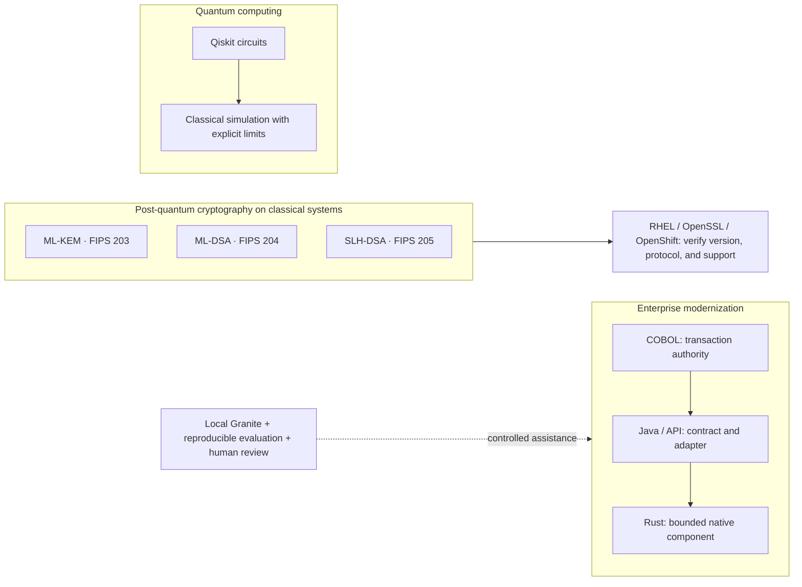

<!-- Purpose: Show conceptual boundaries among research areas and platform components. -->
# Conceptual architecture

Quantum computing research is separate from PQC. The dotted line represents engineering assistance, never decision authority or deployment approval.
